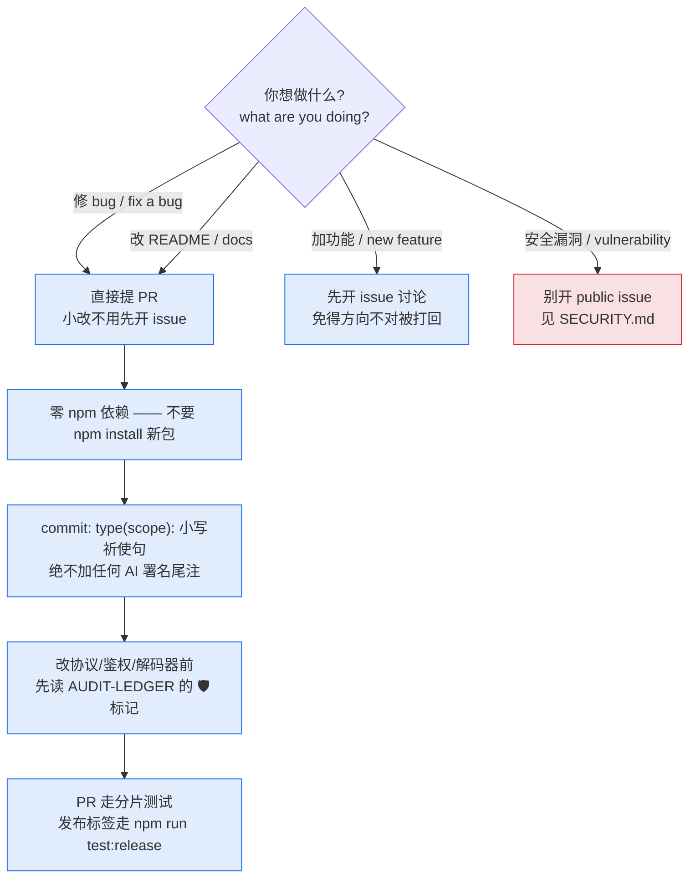

# 贡献指南 / Contributing

<p align="center">
  <a href="#简体中文">简体中文</a> ·
  <a href="#english">English</a> ·
  <a href="docs/AUDIT-LEDGER.md">审计台账</a> ·
  <a href="SECURITY.md">安全问题走这里</a>
</p>



感谢想贡献代码 / Thanks for wanting to contribute.

## 简体中文

### 开始之前

- 想加功能请先开 issue 讨论 免得撸完 PR 方向不对被打回
- 想修 bug 直接提 PR 就行 小改不用先开 issue
- 想改 README / docs 直接 PR
- 不清楚项目结构 看 [README](README.md) 的 "它到底在干嘛" 章节 和 `src/` 下每个文件顶部的注释

### 代码风格

- 项目是 **零 npm 依赖** 纯 `node:*` 内置模块 PR 里不要 `npm install` 新包
- 用 ES Modules (`import/export`) 和 async/await
- 缩进 2 空格 单引号 带分号
- 新文件放 `src/` 对应目录 命名和现有保持一致
- LS 协议相关改动（`windsurf.js` / `proto.js` / `grpc.js`）改字段号时 在 PR 描述里注明来源（参考 proto 文件 / 反编译发现等）
- Dashboard UI 不要用 `alert()` / `confirm()` / `prompt()` 用 `App.confirm()` / `App.prompt()`

### Commit & PR

- commit 格式 `type(scope): 简短说明`，scope 可选但推荐（写受影响的模块）。例：
  - `fix(auth,server): account-pool safety — bounded lockout map, id-based refcount`
  - `feat(devin-connect): tool_call nativization stage-0 — fix double-send, def-gate outer=10`
- type 只用：`feat` / `fix` / `refactor` / `perf` / `docs` / `test` / `chore` / `ci` / `revert`
- subject 全小写英文、祈使句、无句号；多个改动点用 `—`(em dash)接补充、`+` 连列
- 复杂改动写 body（bullet 列表）：每条 `文件: 改了什么（为什么/追溯标记）`，追溯标记如审计 ID(`PNG-1`)、审查缺口(`R2`/`O1`)、issue(`#192`)
- **调试日志不单独成 commit**（不要 `debug:` 类型）；调试代码在合并前清掉或并进功能 commit
- 一个 commit / 一个 PR 解决一件事，多件事按主题拆开
- **绝不在 commit message 里加任何 AI / 助手署名尾注**（`Co-Authored-By: Claude`、`Generated with…` 等一律不写）
- 标题写清楚改了啥，body 写为什么改，而不是怎么改（diff 自己会说）
- 本地启用 commit 模板：`git config commit.template .gitmessage`
- 可选：本地启用 hook，禁止直接在 master 上写 commit（流程是 分支 → 评审 →
  `git merge --ff-only` → 推）：`git config core.hooksPath .githooks`。
  它只挡 `git commit`，不挡 master 前进 —— `--ff-only` 不产生 commit，所以发版流程不受
  影响。刻意例外用 `git commit --no-verify`。
  值得装的理由：直接在 master 上提交产生的历史与 ff 合并**字节级相同**，所以事后看不出
  任何异常，只能在发生的那一刻挡。
  **作用范围（实测，别照直觉推）**：`git commit` 与 `--amend` 拦；`--ff-only` 放行；
  **`cherry-pick` / `revert` 拦不住** —— git 不在那条路径上调 pre-commit，两者都改由
  `post-commit` 事后警告（实测各自都会打印）；冲突的 merge/rebase 会触发，且给的是那个状态
  下**真能执行**的补救命令（`git switch -c` 在合并中会被 git 拒绝）。

### 测试

改动协议层 / 鉴权面 / 解码器前,先看 [docs/AUDIT-LEDGER.md](docs/AUDIT-LEDGER.md) —— 那里记了哪些子系统已被实际探测过、结论如何,以及哪些不变式有突变验证过的守卫。
碰到标 🛡 的地方,注意别把守卫住的性质改掉(例如给路由路径加 URL 解码、
或把 parseFields 改成自动递归)。

本地全量运行 `npm test`。单独运行测试文件时，在仓库根目录运行：

```text
node --import ./test/setup-env.mjs --test test/runtime-config-hardening.test.js
```

测试前备份现有的 `runtime-config.json`。预加载会跳过 `.env`，使用临时数据目录，并限制普通测试访问上游。裸跑 `node --test` 可能改写运行配置。

`npm run test:release` 逐文件启动独立进程。发布计数见对应标签的 Release 工作流 Test 作业日志末尾的测试摘要。
全量 `npm test` 的总数**不再漂**：2026-09-13 实测，真正的原因不是"输出竞态"而是
`--test-force-exit` 会在跑完**部分 suite 之后**就让进程以 **0** 退出 —— 同一份字节跑 10 轮得到
**8 个不同的数字（34…72）**，去掉它之后 **10/10 稳定**（两臂逐轮交错跑，逐轮原始计数在 `939872b` 的 commit message 里，`git show -s --format=%B 939872b` 可复核）。该 flag 已从 `package.json`、
`scripts/run-test-shard.mjs` 与三个 harness 脚本中移除。**不要加回来**：
截断是静默的，而挂起会被 shard runner 点名。

**门禁全绿并不等于你没弄坏东西。** 测试套件**不跑**突变 spec（`test/mutations/*.json`），
所以如果你改的那一行正好是某条突变的 anchor，它会静默失配 —— 而你和 CI 都看不见。
PR #241 真发生过这件事：贡献者的套件全绿、维护者复测也全绿、合并后的门禁也全绿，
三个绿灯都没看见两条 anchor 已经断了。改动测试所锚定的代码时，按[下方 Linux/POSIX 与 Windows 步骤](#testing)复测。突变复测需独占干净的已提交检出，并依赖可信绝对路径上的 POSIX Git。Windows 使用 WSL Linux 检出。

`npm run secret-scan` 扫描工作树。`npm run gate` 还会检查突变规格与受影响的基线、运行发布测试并检查暂存和未暂存的空白问题。增量基线检查需要 `origin/master`。按[下方宿主示例](#testing)通过 `GATE_INERT_SKIP_PATHS` 声明整文件跳过。声明的跳过项仍属于未执行的覆盖。

提 PR 时建议在描述里补充：

- 跑了什么 curl 命令 / smoke 场景
- dashboard 哪个面板点了
- 复测了哪些模型（gpt-4o-mini 这类免费模型最方便）

### 审查与合并标准

这个仓库的合并标准此前只以 review 评论形式存在（7 条正式 review：#90 #142 #198 #232 #255 #256 #274，外加 ~40 条长评论；#276 在 2026-10-05 又追加 2 条 CHANGES_REQUESTED → 现为 **9 条 / 8 个 PR**（截至 2026-10-15），最新计数见 [交接文档 §2.1](docs/HANDOFF-2026-10-15.md)，本文不复述）。以下是它的成文版;引文逐字未改,每条附出处。

**元规则 —— 什么才算守卫(RC0):** 守卫只有在**把修复回退后它会变红、且是在生产实际走的那个形状上变红**,才算守卫。—— #252 / #261

- 正面实例(#261,走倒车实测):"**走倒车**实测(这是它算不算守卫的判据):把 `chat.js:3313` 的调用行删掉,新测试**红**"（引文坐标是 2026-09-13 的树；同一调用点现在 `chat.js:3384-3386`——引文逐字未改，只补坐标）
- 反面实例(#252):"**Non-stream passes by accident, through two unrelated mechanisms.**"

**开 PR 前自答(有一条答不上来,先别开):**

- [ ] 修复键在**失效特征**上,还是键在模型名 / 单个字面量上?(RC4 —— 整类都修了吗,RC5)
- [ ] 涉及 wire 协议:字段号**来源**注明了没有?未实测的坐标默认关、注释里直说不确定了吗?(RC1)
- [ ] 你声称"守住了"的东西,把修复回退后测试会红吗?红在生产实际走的那个形状上吗?(元规则)
- [ ] 测试钉的是上游身份 / 行为,还是只钉了 codec?(RC7)
- [ ] 要声明漏网?前提是**让它无害**,不是"工具还没建"。(RC8)
- [ ] 每个数字都带上产生它的命令了吗?跳过的门禁声明了没有(`GATE_INERT_SKIP_PATHS`,见上文「测试」),并且没有被报成绿?(数量规则 / RC10)
- [ ] 这个 PR 只有一件事吗?无关的 hunk 拿掉了吗 —— CI 绿不是留下它的理由。(RC6)
- [ ] 常量的依据在哪?注释里的理由对吗?(RC11 / RC12)

#### 十二条拒绝标准

每条 = 一句规范 + 最短逐字引文 + 出处。

1. **RC1 未标定的 wire 坐标不得作为默认值。** "That only proves the decoder reads tag 22. Change the default to `^23` and keep the test writing 22, the suite stays green." —— #256 M1
2. **RC2 请求侧的 wire 形状要真实抓包;解码侧知识不是证据。** "**这是解码侧的已知事实,推不出请求侧的形状。** ... **给我一段真实 CLI 在「一轮多 call」时的请求帧,哪怕只是 hex,这半我也收。**" —— #267 M1
3. **RC3 只认观测到的 SKU;不要前缀匹配,不要未锚定正则。** "请把两处都锚成**只认观测到的 SKU**。" —— #266 M5
4. **RC4 修复要键在失效特征上,绝不能键在模型名上。** "你把修复键在**失效特征**(reasoning-only finish + 有 tools)而不是模型名上,这个选择是对的,而且比「给 swe-1-7 开个特例」耐用得多 —— **本仓库吃过好几次「按模型名硬编码」的亏**。" —— #238
5. **RC5 修这一类,否则不合入。** "**It fixes a whole class, not one string.**" —— #219;配对理由:类修复同时也是更小的 diff —— "No new export in `identity-neutralize.js`, no new call site in `chat.js` — the net diff ends up smaller than what you have now"
6. **RC6 一个 PR 一件事;无关的 hunk 即便 CI 绿也否决**(规则本身见上文「Commit & PR」,这里补的是它的判例)。"**Per CONTRIBUTING, one PR per concern; it also keeps `git bisect` honest later.**" —— #219
7. **RC7 钉住 codec 而非上游身份的测试不算。** "Default-on `^22` / PlanStatus `#19/#20` — I attacked the tests: they pin the codec, not upstream identity, same class as `IMAGE_TAG` `#4`." —— #256 M1
8. **RC8 声明漏网要的是"无害的前提",不是"工具缺失"。** "可以接受,前提是**给出让它无害的前提**。你给的是「工具还没建」—— 那是「没守卫」,不是「无害」。" —— #242 M2
9. **RC9 声明的测试结果要在干净 master 上核对;不准确的代价大于失败。** "本仓库合并前会逐条核实提交者的诊断链,所以**测试结论的准确性比它是否通过更重要** —— 一条不实的声明会让整份验证结果都需要重新核对。" —— #232
10. **RC10 跳过的门禁绝不报成绿。** "**Not treating a skipped gate as green**" —— #256
11. **RC11 无解释的常量是 blocker;依据是作者的活,数值是维护者的决定。** "请说一下 100m 是怎么来的:是最坏情况实测(多图 + 大 payload),还是取的整档? ... **这个数我倾向由你给依据、我拍板**" —— #265 M2
12. **RC12 理由写错的注释是缺陷,即使行为是对的。** "注释把理由写错了,而错的理由比没有注释危险:下一个人读到「救援会自然触发」,就不会再去验它。**本仓库栽在这个形状上不止一次(注释把意图写对、实现少一环、而注释读起来完全正确)。**" —— #243 M2

#### 两条作用域规则(效力等同拒绝标准)

1. **本仓库不是通用 OpenAI 兼容多路复用器。** "This repo turns Windsurf / Devin into OpenAI / Anthropic / Gemini. **It is not a generic OpenAI-compatible multiplexer.**" —— #259
2. **被取代的 PR 关为 superseded,不留着。** "请你把 #267 关成 superseded(或先转 draft,等有一轮多 call 的真实 CLI 请求帧再开)。我这边不替你关。" —— #267

#### 成熟 review 的形态

2026-07-28..09-16 一段的 review 固定产出四样:

1. 测量表:**head SHA + baseline SHA**,并声明 worktree 已隔离;
2. 发现按 **M1 / M2 / M3** 编号,分级 **blocker / major / nit**;
3. 显式合并闸门;
4. 显式列出**没有改什么、以及为什么**。

#### 两条散落别处的规则

- **数字要带上产生它的命令。** 复述一个没重跑过的数字,就是错误主张进入 review 的通道 —— 本项目实测:89/89 条自带运行命令的声明成立;错的声明全是没人重跑的复述。原话:"引用测量日期,否则重新测。"
- **跳过的门禁绝不报成绿(RC10)。** CI 绿 + 跳过一门,不等于门禁全绿。宿主上合法地不执行测试的文件,用 `GATE_INERT_SKIP_PATHS` 声明(机制见上文「测试」);声明了测试却不执行、又不声明的文件,门禁照红。

### CI

GitHub Actions 在 PR 和 `master` 推送上运行独立的语法检查，并按 `npm run test:shard -- N 4` 运行四个测试分片（`N` 为 0–3）。`v*` 标签触发 Release 工作流。Test 作业检查标签版本，选择严格祖先发布标签作为 wire 基线，扫描秘密，测量全部突变基线并运行 `npm run test:release`。

---

## English

### Before you start

- Got a feature idea? Open an issue first so we can discuss direction.
- Fixing a bug? Just send the PR.
- README / docs changes? Just send the PR.
- Unclear about project structure? See [README](README.md) "What it does" section and the header comments in each `src/` file.

### Code style

- **Zero npm dependencies** — pure `node:*` builtins only. No `npm install` in PRs.
- ES Modules (`import/export`), async/await.
- 2-space indent, single quotes, semicolons.
- Put new files under `src/` in the matching directory. Follow existing naming.
- LS protocol changes (`windsurf.js` / `proto.js` / `grpc.js`): note the source of any new field numbers in the PR description.
- Dashboard UI: use `App.confirm()` / `App.prompt()` instead of native `alert()` / `confirm()` / `prompt()`.

### Commits & PRs

- Format: `type(scope): short description`. Scope optional but encouraged (the modules touched). e.g.
  - `fix(auth,server): account-pool safety — bounded lockout map, id-based refcount`
  - `feat(devin-connect): tool_call nativization stage-0 — fix double-send, def-gate outer=10`
- Types (only): `feat` / `fix` / `refactor` / `perf` / `docs` / `test` / `chore` / `ci` / `revert`.
- Subject: lowercase, imperative, no trailing period; join extra clauses with `—` (em dash), list items with `+`.
- Non-trivial changes get a body (bullet list): each line `file: what changed (why / trace tag)`, where a trace tag is an audit ID (`PNG-1`), review gap (`R2`/`O1`), or issue (`#192`).
- **Debug logging is never its own commit** (no `debug:` type); strip debug code before merge or fold it into the feature commit.
- One commit / one PR per concern. Split unrelated changes.
- **Never add any AI / assistant attribution trailer** to a commit message (`Co-Authored-By: Claude`, `Generated with…`, etc.).
- Title = what changed. Body = why (the diff speaks for how).
- Enable the commit template locally: `git config commit.template .gitmessage`
- Optional: enable the hook that refuses commits authored directly on master — the flow is
  branch → review → `git merge --ff-only` → push: `git config core.hooksPath .githooks`.
  It blocks `git commit` only, not master advancing (`--ff-only` creates no commit, so the
  release flow is untouched). Deliberate exception: `git commit --no-verify`.
  **Scope, measured — do not infer it**: `git commit` and `--amend` are blocked; `--ff-only`
  passes; **`cherry-pick` / `revert` are NOT blocked** (git never consults pre-commit there),
  so a companion `post-commit` hook warns after the fact for both — verified end to end for
  each route; a conflicted
  merge/rebase does fire, and prints recovery advice that actually works in that state
  (`git switch -c` is rejected by git mid-merge).
  Worth installing because committing straight to master yields history that is
  **byte-identical** to the ff-merge — nothing looks wrong afterwards, so the only useful
  moment to catch it is when it happens.

### Testing

Before touching the protocol layer, the auth surface or a decoder, read [docs/AUDIT-LEDGER.md](docs/AUDIT-LEDGER.md) — it records which subsystems have actually
been probed, what the conclusion was, and which invariants have mutation-verified guards.
Where you see 🛡, take care not to change the guarded property (e.g. adding URL decoding to
the routed path, or making parseFields recurse).

Run `npm test` for the full local suite. For a single file, run this from the repository root:

```text
node --import ./test/setup-env.mjs --test test/runtime-config-hardening.test.js
```

Back up an existing `runtime-config.json` before testing. The preload skips `.env`,
uses a temporary data directory, and blocks upstream requests in ordinary tests.
A bare `node --test` can rewrite operator settings.

`npm run test:release` runs one process per file. Find release test counts in the
test summary in the corresponding tag's Release workflow Test job log.
Totals from a plain `npm test` **no longer drift**: measured 2026-09-13, the cause was not
an "output race" but `--test-force-exit` ending the process after **part of the suites** and
still exiting **0** — ten identical runs of one file gave **eight distinct counts (34..72)**,
and **10/10 stable** without it (both arms interleaved round by round; the per-round raw counts
are in `939872b`'s commit message — `git show -s --format=%B 939872b`). The flag was removed from `package.json`,
`scripts/run-test-shard.mjs` and the three harness scripts. **Do not re-add it**: a truncation is
silent, a hang is named by the shard runner.

**A green gate does not mean you broke nothing.** The test suite does **not** run the mutation
specs (`test/mutations/*.json`), so if you edit a line one of them anchors on, the anchor
silently stops matching — invisibly to both you and CI. This really happened on PR #241: the
contributor's suite was green, the maintainer's re-run was green, and the post-merge gate was
green, and all three missed two broken anchors.

**Incremental gate (native Windows PowerShell or POSIX):**

```text
npm run gate
```

It checks mutation specs, measures changed baselines against `origin/master`, runs
`npm run secret-scan` and `npm run test:release`, and checks staged and unstaged whitespace.
Keep the `origin/master` ref available for the incremental baseline check. Every step prints
PASS/FAIL and its exit code. The release result includes explicit skips. Mutations print SKIP because they are not part
of this incremental command. Exit 0 is incremental success, 1 a failed check, 2 missing or
untrustworthy evidence. PR CI deliberately does not run mutations because of their cost.

The working-tree scan cannot see a credential that was committed and then deleted — it is
still in every clone. CI's `history-secrets` job runs `node scripts/history-secret-scan.mjs`
over every blob in every ref plus the unreachable objects an amend/rebase/force-push leaves
behind. Reviewed historical findings live in `scripts/history-secret-scan.baseline`, one
line each with a reason; a new leak is not in that file and fails the job. It is not part of
`npm run gate`: it walks the whole object database (~15 s on a 1.9k-commit history) and no
working-tree change can alter its answer.

**A test file that declares tests but executes none has to be declared.** The shard summary
folds such a file into a skip total, so on a host where 4813 tests ran and 6 files did not, the
verdict still reads PASS and the only trace is `79 skip` in a detail line. The gate now names
the files and how many tests each declared, because a total cannot be acted on and a path can.

To be precise about what this does and does not catch: a module that **throws while loading**
does not slip through. A top-level throw in an imported module makes the file fail
(`fail 1`), which the `fail` count has always caught. What was invisible is the opposite case
— deliberate, reason-carrying skips that a reader scanning a green line can mistake for
coverage.

Partial skips stay legal — platforms legitimately gate fixtures. The real-Git fixtures are the
standing example: they skip on any host without `git` at a trusted absolute POSIX path, by
design (`test/git-fixture-env.js`, asserted in `test/git-fixture-availability.test.js`). Declare
what you accept on your host; the value is host-specific — the sets below are what each host
*measures*, not a universal list. For a POSIX host with wire comparison, live relogin and
detach soak disabled, use:

```bash
export GATE_INERT_SKIP_PATHS='test/wire-byte-identity.test.js;test/devin-connect-relogin-live.test.js;test/detach-soak.test.js'
```

`test/wire-byte-identity.test.js` skips without `WIRE_BASE_TREE` because it is a CI-only
comparison; `test/devin-connect-relogin-live.test.js` skips its whole suite at the describe
level when not armed (`RELOGIN_LIVE=1` plus credentials) and reports `tests 0 / suites 1 /
skipped 0`. A native Windows host measures six (2026-10-26, final tree): it also lacks
`/usr/bin/git`, so `test/mutate-verify-harness.test.js` and
`test/self-update-untracked-safety.test.js` execute nothing there (`REAL_GIT` is null;
`test/git-fixture-env.js` requires git at a trusted absolute POSIX path). `test/detach-soak.test.js`
is a suite-level skip unless `DETACH_SOAK=1` (it needs a real 120 s TTL), and
`test/detach-ls-pool-pressure.test.js` skips its POSIX-only pressure arms on Windows
(`ensureLs` must spawn a shebang fake LS). The full measured Windows set is:

```powershell
$env:GATE_INERT_SKIP_PATHS = 'test/wire-byte-identity.test.js;test/devin-connect-relogin-live.test.js;test/mutate-verify-harness.test.js;test/self-update-untracked-safety.test.js;test/detach-soak.test.js;test/detach-ls-pool-pressure.test.js'
```

Semicolon- or newline-separated, repo-relative, `/` or `\`. The variable is an override with no
default: unset means accept nothing, so an unreviewed file that starts executing nothing while
declaring work — the shape the census names — still fails. A module that throws while loading is
not that shape: it fails the file (`tests 1 / fail 1`, exit 1), which the `fail` count has always
caught; a file that declares nothing at all is no evidence either. Entries that match nothing are
reported as `unused` — a stale entry is a claim about the host that has stopped being true.

**Full gate on Linux/POSIX** (Node >= 22.13 — the release gate runs Node 24 — plus npm, Git and
Bash; clean committed checkout). Set the POSIX skip list above for your host first:

```bash
set -eu
[ -z "$(git status --porcelain)" ] || { echo 'Commit changes before mutation validation'; exit 2; }
npm ci
npm run gate
set -- test/mutations/*.json
[ -f "$1" ] || { echo 'No mutation specs'; exit 2; }
expected=$#; completed=0; failed=0
for spec do
  code=0
  npm run mutate -- "$spec" || code=$?
  printf 'VERDICT %s exit=%s\n' "$spec" "$code"
  completed=$((completed + 1))
  if [ "$code" -ne 0 ]; then failed=1; fi
done
[ "$completed" -eq "$expected" ] || exit 2
printf 'VERDICT coverage: %s/%s\n' "$completed" "$expected"
[ "$failed" -eq 0 ]
```

**Full gate from Windows PowerShell:** set the PowerShell skip list above for your host. Run
the incremental command natively, then run the POSIX fixtures in a clean WSL Linux clone of
the **same committed HEAD**. Do not add Git for Windows paths to the trusted POSIX fixture
candidates. WSL needs Linux Node, npm, Git and Bash on the non-interactive PATH. Adjust the
POSIX skip list in the script if you enable the wire, live relogin or detach soak fixtures.
Keep the native skip report and the Linux mutation results for review.

```powershell
$ErrorActionPreference = 'Stop'
npm run gate
if ($LASTEXITCODE -ne 0) { exit $LASTEXITCODE }
if (git status --porcelain) { throw 'Commit changes before mutation validation' }
$owner = (git rev-parse --show-toplevel).Trim()
if ($LASTEXITCODE -ne 0) { throw 'Not a Git checkout' }
$commit = (git rev-parse HEAD).Trim()
$linuxOwner = wsl --exec wslpath -a -- $owner
if ($LASTEXITCODE -ne 0) { throw 'WSL path conversion failed' }
$linuxOwner = $linuxOwner.Trim()
$script = @'
set -eu
owner=$1; commit=$2
export GATE_INERT_SKIP_PATHS='test/wire-byte-identity.test.js;test/devin-connect-relogin-live.test.js;test/detach-soak.test.js'
scratch=$(mktemp -d)
trap 'rm -rf "$scratch"' EXIT
# --no-local transfers Git objects rather than hard-linking across filesystems.
git -c core.autocrlf=false clone --no-local --quiet -- "$owner" "$scratch/repo"
cd "$scratch/repo"
git checkout --quiet --detach "$commit"
[ "$(git rev-parse HEAD)" = "$commit" ] || exit 2
npm ci
npm run gate
set -- test/mutations/*.json
[ -f "$1" ] || { echo 'No mutation specs'; exit 2; }
expected=$#; completed=0; failed=0
for spec do
  code=0
  npm run mutate -- "$spec" || code=$?
  printf 'VERDICT %s exit=%s\n' "$spec" "$code"
  completed=$((completed + 1))
  if [ "$code" -ne 0 ]; then failed=1; fi
done
[ "$completed" -eq "$expected" ] || exit 2
printf 'VERDICT coverage: %s/%s\n' "$completed" "$expected"
[ "$failed" -eq 0 ]
'@
$localScript = [IO.Path]::GetTempFileName()
try {
  [IO.File]::WriteAllText($localScript, ($script -replace "`r", ''), [Text.UTF8Encoding]::new($false))
  $linuxScript = wsl --exec wslpath -a -- $localScript
  if ($LASTEXITCODE -ne 0) { throw 'WSL script path conversion failed' }
  $linuxScript = $linuxScript.Trim()
  wsl --exec bash $linuxScript $linuxOwner $commit
  if ($LASTEXITCODE -ne 0) { throw "Linux full gate failed: exit=$LASTEXITCODE" }
} finally {
  Remove-Item -LiteralPath $localScript -Force
}
```

The mutation step holds its checkout exclusively (write, test, restore). Do not edit that
checkout while it runs. In your PR description, also include:

- What curl commands or smoke scenarios you ran
- Which dashboard panels you clicked through
- Which models you tested (free ones like `gpt-4o-mini` are easiest)

### Review & merge bar

This repository's merge bar has only ever existed in review comments (7 formal reviews — #90 #142 #198 #232 #255 #256 #274 — plus ~40 long issue comments; #276 added two more CHANGES_REQUESTED on 2026-10-05, so the current count is **9 across 8 PRs** as of 2026-10-15 — the live number lives in handoff §2.1). This is that bar in writing; every quote is verbatim, with its PR.

**Meta-rule — what counts as a guard (RC0):** a guard counts only if **reverting the fix turns it red, and it turns red in the shape production actually takes**. — #252 / #261

- Positive instance (#261, the reverse-the-fix measurement): "**走倒车**实测(这是它算不算守卫的判据):把 `chat.js:3313` 的调用行删掉,新测试**红**" (the quoted coordinate is the 2026-09-13 tree; the same call site is now `chat.js:3384-3386` — the quote stays verbatim, only the coordinate is added)
- Negative instance (#252): "**Non-stream passes by accident, through two unrelated mechanisms.**"

**Self-check before opening a PR (if one item has no answer, fix that first):**

- [ ] Is the fix keyed on the **failure signature**, not a model name or one literal? (RC4 — did you fix the whole class, RC5)
- [ ] Wire protocol: is the field-number **source** cited, and are unmeasured coordinates default-off with a comment that says so? (RC1)
- [ ] For anything you claim is "guarded": does reverting the fix turn the test red — in the shape production takes? (meta-rule)
- [ ] Do the tests pin upstream identity / behaviour, or only the codec? (RC7)
- [ ] Declaring a gap? The premise must be that it is harmless, not that the tool is missing. (RC8)
- [ ] Does every number carry the command that produced it? Is every skipped gate declared (`GATE_INERT_SKIP_PATHS`, see Testing above) and none reported as green? (number rule / RC10)
- [ ] Is this PR one concern? Are unrelated hunks gone — green CI is not a reason to keep them. (RC6)
- [ ] Is every constant explained, and every comment's reason true? (RC11 / RC12)

#### The twelve rejection criteria

Each: a one-line rule + the shortest verbatim quote + its PR.

1. **RC1 Unmeasured wire coordinates must not ship as defaults.** "That only proves the decoder reads tag 22. Change the default to `^23` and keep the test writing 22, the suite stays green." — #256 M1
2. **RC2 A request-side wire shape needs a real capture; decoder-side knowledge is not evidence.** "**这是解码侧的已知事实,推不出请求侧的形状。** ... **给我一段真实 CLI 在「一轮多 call」时的请求帧,哪怕只是 hex,这半我也收。**" — #267 M1
3. **RC3 Only observed SKUs — no prefix matching, no unanchored regexes.** "请把两处都锚成**只认观测到的 SKU**。" — #266 M5
4. **RC4 Key the fix on the failure signature, never on the model name.** "你把修复键在**失效特征**(reasoning-only finish + 有 tools)而不是模型名上,这个选择是对的,而且比「给 swe-1-7 开个特例」耐用得多 —— **本仓库吃过好几次「按模型名硬编码」的亏**。" — #238
5. **RC5 Fix the class, or it does not merge.** "**It fixes a whole class, not one string.**" — #219; paired rationale — the class fix is also the smaller diff: "No new export in `identity-neutralize.js`, no new call site in `chat.js` — the net diff ends up smaller than what you have now"
6. **RC6 One PR, one concern; unrelated hunks are rejected even when CI is green** (the rule itself is under Commits & PRs above — this adds its case law). "**Per CONTRIBUTING, one PR per concern; it also keeps `git bisect` honest later.**" — #219
7. **RC7 Tests that pin the codec rather than upstream identity do not count.** "Default-on `^22` / PlanStatus `#19/#20` — I attacked the tests: they pin the codec, not upstream identity, same class as `IMAGE_TAG` `#4`." — #256 M1
8. **RC8 A declared gap needs a harmless premise, not a missing tool.** "可以接受,前提是**给出让它无害的前提**。你给的是「工具还没建」—— 那是「没守卫」,不是「无害」。" — #242 M2
9. **RC9 Verify claimed test results on a clean master; an inaccurate claim costs more than a failure.** "本仓库合并前会逐条核实提交者的诊断链,所以**测试结论的准确性比它是否通过更重要** —— 一条不实的声明会让整份验证结果都需要重新核对。" — #232
10. **RC10 A skipped gate is never reported as green.** "**Not treating a skipped gate as green**" — #256
11. **RC11 An unexplained constant is a blocker; the author supplies the rationale, the maintainer decides the value.** "请说一下 100m 是怎么来的:是最坏情况实测(多图 + 大 payload),还是取的整档? ... **这个数我倾向由你给依据、我拍板**" — #265 M2
12. **RC12 A comment whose reason is wrong is a defect, even when the behaviour is right.** "注释把理由写错了,而错的理由比没有注释危险:下一个人读到「救援会自然触发」,就不会再去验它。**本仓库栽在这个形状上不止一次(注释把意图写对、实现少一环、而注释读起来完全正确)。**" — #243 M2

#### The two scope rules (the same force as rejection criteria)

1. **This is not a generic OpenAI-compatible multiplexer.** "This repo turns Windsurf / Devin into OpenAI / Anthropic / Gemini. **It is not a generic OpenAI-compatible multiplexer.**" — #259
2. **A superseded PR is closed, not left open.** "请你把 #267 关成 superseded(或先转 draft,等有一轮多 call 的真实 CLI 请求帧再开)。我这边不替你关。" — #267

#### The shape of a mature review

Reviews in the 2026-07-28..09-16 period settled into four artifacts:

1. a measurement table: **head SHA + baseline SHA**, with an explicit statement that the worktree was isolated;
2. findings numbered **M1 / M2 / M3**, graded **blocker / major / nit**;
3. an explicit merge gate;
4. an explicit list of **what the reviewer did not change, and why**.

#### Two rules stated elsewhere

- **A number carries the command that produced it.** Restating a figure nobody re-ran is how a wrong claim enters a review — measured on this project: 89 of 89 claims that carried a run command held; every wrong claim was a restatement nobody ran. The source's lesson, verbatim: "引用测量日期,否则重新测。"
- **A skipped gate is never reported as green (RC10).** Green CI plus a skipped gate is not a green gate. A file that legitimately executes no tests is declared via `GATE_INERT_SKIP_PATHS` (mechanism under Testing above); a file that declares tests, executes none, and is not declared still fails the gate.

### CI

PR and `master` push CI run a separate syntax job and four test jobs via
`npm run test:shard -- N 4` (N = 0–3). A pushed `v*` tag triggers the Release workflow.
Its Test job checks the tag version, selects a strict-ancestor release tag for the wire
baseline, scans for secrets, measures every mutation baseline, and runs `npm run test:release`.

### Offline Connect transport check

Run `node scripts/load-connect-offline.mjs ok 8 2` to send eight requests
through the real gateway with at most two in flight. The command starts a
loopback Connect peer, creates temporary synthetic accounts, blocks external
network access, and prints the status, number of upstream attempts, and p50/p95
latency. It accepts up to 64 requests and eight workers. These timings measure
the local gateway and fixture together.

Use `node scripts/load-connect-offline.mjs precommit 1 1` for a refusal before
output. Use `node scripts/load-connect-offline.mjs postcommit 1 1` for a refusal
after the first content frame. These cases check that a client receives one
complete response after failover or one partial response with a terminal error.
