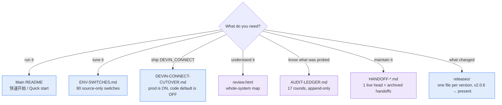

# WindsurfAPI Docs

  <a href="#-just-want-to-run-it">Run it</a> ·
  <a href="#-operating-it">Operate it</a> ·
  <a href="#-understand-the-internals">Internals</a> ·
  <a href="#-taking-this-project-over-read-these-three-in-this-order">Take it over</a> ·
  <a href="../README.md">← Main README</a>

> **Which door is yours?** This directory holds the project's tracked documentation — count it
> with `git ls-files docs/` — most of it append-only records aimed at whoever maintains the
> project next. The tables below are the short paths in. If you only want the gateway
> running, you need nothing under "Take it over".
>
> Full inventory: [DOC-MAP.md](DOC-MAP.md) — one line per tracked document with purpose and
> current / stale / duplicate status.

Project-level entry points: [CONTRIBUTING.md](../CONTRIBUTING.md) (merge bar, review rules and
testing) · [CHANGELOG.md](../CHANGELOG.md) (version index) · [README.en.md](../README.en.md)
(English README).

蓝 = 用户向 · 紫 = 维护者向 / blue = for users, purple = for maintainers

## 🚀 Just want to run it

| Goal | Go here |
|---|---|
| Install and send a first request | **[Main README → 快速开始](../README.md#快速开始)** |
| Point Claude Code / Cline / Cursor at it | [Main README → 客户端接入](../README.md#claude-code--cline--cursor-怎么用) |
| See which models are available | [Main README → 模型清单](../README.md) — the `/v1/models` endpoint is authoritative |

## 🔧 Operating it

| Goal | Go here |
|---|---|
| Tune behaviour without touching code | **[ENV-SWITCHES.md](ENV-SWITCHES.md)** — the 90 switches that exist only in source. Read its header first: it explains how to count them correctly, because a bare `env.` grep sees only 127 of the 185 (2026-11-10) |
| Update a Docker deployment in one command | **[DOCKER-UPDATE.md](DOCKER-UPDATE.md)** — pull/build → health gate → automatic rollback; data volumes untouched |
| Measure the detached-cache rollout gates | **[DETACH-ROLLOUT.md](DETACH-ROLLOUT.md)** — gate 2 stress procedure and the two-week gate 1 serve/admit measurement; default stays OFF until both pass |
| Take `DEVIN_CONNECT` to production | **[DEVIN-CONNECT-CUTOVER.md](DEVIN-CONNECT-CUTOVER.md)** — production runs with this ON while the code default is OFF, so this is not optional reading |
| Log in / add an account (password, email code, token, Devin) | **[login-flows.md](login-flows.md)** — the probe-first rules, the exact click path for each account shape, and the CDP token capture |
| Localise the dashboard | [dashboard-i18n.md](dashboard-i18n.md) |
| Verify a release download / understand the OTA trust boundary | [RELEASE-SIGNING.md](RELEASE-SIGNING.md) — cosign keyless signatures (GitHub OIDC, no key material in the repo), the exact `verify-blob` commands, what the signature does and does not prove, and the D9 controls for Docker digest signing and source-OTA attestation |
| Audit the D9 supply-chain controls | [D9-GATE.md](../evidence/final/D9-GATE.md) (single-Owner trust assessment) with [BannerLock.md](../evidence/final/BannerLock.md), [DockerSign.md](../evidence/final/DockerSign.md) and [SourceAttest.md](../evidence/final/SourceAttest.md) — what is implemented, what stays `[UNVERIFIED]`, and the residual Owner-channel risk |
| See what changed in a version | [releases/](releases/) — one file per version, v2.0.6 → present (219 release notes, 2026-11-10) |

## 🔬 Understand the internals

| Goal | Go here |
|---|---|
| Get the whole map in one page | **[Architecture Review](review.html)** — startup → routes → protocol bridge → account/LS pools → dashboard → security boundaries |
| Know which subsystems were actually probed, and what the conclusion was | **[AUDIT-LEDGER.md](AUDIT-LEDGER.md)** — start with its `怎么读这份文件` section; the file is appended per round and is not organised by topic |
| Know which release claims were **never** verified | **[UNVERIFIED.md](UNVERIFIED.md)** — every bullet filed under a release note's 「尚未验证」 section, grouped by release with a 已复核 / 仍缺 / 已修 status column; regenerated from the notes by `scripts/unverified-register.mjs`, so it cannot drift |
| Understand reasoning/content dedup | [reasoning-dedup.md](reasoning-dedup.md) |
| Look up what this repo's own PRs and issues decided, offline | [GITHUB-CORPUS.md](GITHUB-CORPUS.md) — the local corpus of all 89 PRs / 183 issues (snapshot 2026-10-15): what it captures, its schema, the read-only rebuild, the query tool, and the coverage gaps |

---

## 🛠 Taking this project over? Read these three, in this order

| # | File | Why |
|---|---|---|
| 1 | **[HANDOFF-2026-10-15.md](HANDOFF-2026-10-15.md)** | Current state (its §0 names the live product tag and SHA), the inbound queue (every open PR/issue with a verdict and its evidence), what is frozen or owner-gated, the local-only assets that never reach git, and the gap register. Read §1 first (operational traps), then §3 (what is deliberately not done). OTA follows the latest annotated tag, not later untagged SHAs. |
| 2 | **[AUDIT-LEDGER.md](AUDIT-LEDGER.md)** | Which subsystems were *actually probed*, the conclusion, and where the guard lives. Start with its "怎么读这份文件" section: the file is appended to per round and is **not** organised by topic, so that section is the only reliable entry point. It states its own round count and line-scale — **this row deliberately states neither**, because both belong to a file that grows every round, and the version of this row that did cite a round count went stale twice. |
| 3 | **[DEVIN-CONNECT-CUTOVER.md](DEVIN-CONNECT-CUTOVER.md)** | Production cutover runbook. `DEVIN_CONNECT` is what production actually runs (the code default is OFF; the deployment sets it), so this is not optional. Paid wire-calibration procedure in §8. |

For the one-page end-of-session snapshot — delivered versions, fixes, audits, tests, D9 controls, open items and the command that verifies each — read **[HANDOFF-SUMMARY.md](HANDOFF-SUMMARY.md)**.

Two sections are worth reading even though they sit in superseded files:

- **[HANDOFF-2026-08-04-B.md](HANDOFF-2026-08-04-B.md) §5** — the best single section in these
  docs. §5.1 ("fixes themselves need a review pass") is why that round found six defects in
  its own repairs.
- **[HANDOFF-2026-08-04-E.md](HANDOFF-2026-08-04-E.md) §5.1** — a *correction* written into the
  audit ledger that was itself wrong. Worse than a wrong claim, because a correction makes the
  next reader stop doubting that spot. Its §7 is the companion piece: a later round put a
  *second* wrong number into the very passage that was fixing the first two.

### The rest of the handoffs are archive

Newest first. Every archived handoff carries a banner naming the current handoff **and** a link back to this
index, so whichever one you open by accident, you are two clicks from the right place. That is
worth keeping: **`ls docs/` does not sort chronologically** — `-B.md` sorts before `.md` (so the
original `08-04` sorts *after* B/C/D/E), and `HANDOFF-2026-08-05.md` has a wrong filename date
(the work was 08-04, it covers v3.9.12, and it is the fifth-oldest despite sorting last).
Trust this list, not the directory listing.

| Handoff | Covers |
|---|---|
| [09-22](HANDOFF-2026-09-22.md) | 工程审计收口（有限审计快照，不是产品状态） |
| [09-17-B](HANDOFF-2026-09-17-B.md) | v3.9.36–v3.9.40 — 被 10-15 取代 |
| [09-17](HANDOFF-2026-09-17.md) | v3.9.36 — 审查前的状态;锁仍是旧实现 |
| [09-16](HANDOFF-2026-09-16.md) | v3.9.35 — PR #271 合入前的状态 |
| [08-20](HANDOFF-2026-08-20.md) | v3.9.25–v3.9.34 — 面板 401、旱灾名单、Connect 目录、四条外部 PR |
| [08-06](HANDOFF-2026-08-06.md) | v3.9.20 — Gemini tool-args, then the live head moved here |
| [08-04-E](HANDOFF-2026-08-04-E.md) | v3.9.17–v3.9.19 — PR #241 merged, the digest ceiling and its missing half, the post-release fan-out review |
| [08-04-D](HANDOFF-2026-08-04-D.md) | v3.9.15 — #234's last criterion, Cascade stream spend, CI node24 |
| [08-04-C](HANDOFF-2026-08-04-C.md) | v3.9.14 — #240 budget split |
| [08-04-B](HANDOFF-2026-08-04-B.md) | v3.9.13 — caller-shard fix, `npm run mutate`, git hooks |
| [08-05](HANDOFF-2026-08-05.md) | v3.9.12 — queue-on-pin (**misdated filename**) |
| [08-04](HANDOFF-2026-08-04.md) | v3.9.9–v3.9.11 — its §3 corrects four earlier claims |
| [08-03-B](HANDOFF-2026-08-03-B.md) | v3.9.8 |
| [08-03](HANDOFF-2026-08-03.md) | the first #234 analysis |
| [07-27](HANDOFF-2026-07-27.md) | v3.9.0–v3.9.6 |

Handoffs are **append-only**: a superseded one keeps its original conclusions, wrong ones
included, because how a conclusion was reached is part of the record. For current state, the
newest always wins.

## 📜 History ledger (frozen 2026-08-11 / v3.9.21)

The pre-v3.9.22 history is a separate append-only ledger, frozen at **2026-08-11 / v3.9.21**.
It is **not current state** — its own banner says so. Use it for archaeology, not for today's
status.

- [HISTORY-LEDGER.md](HISTORY-LEDGER.md) — global timeline, contributor map, bug-fix index and
  the "糊涂事清单"; the main entry point.
- Detailed slices: [2026-04-early](HISTORY-LEDGER-2026-04-early.md) ·
  [2026-04-late](HISTORY-LEDGER-2026-04-late.md) ·
  [2026-05-bridge](HISTORY-LEDGER-2026-05-bridge.md) ·
  [2026-06-connect](HISTORY-LEDGER-2026-06-connect.md) ·
  [2026-07-early](HISTORY-LEDGER-2026-07-early.md) ·
  [2026-07-mid](HISTORY-LEDGER-2026-07-mid.md) ·
  [2026-07-late](HISTORY-LEDGER-2026-07-late.md) ·
  [2026-08-feature](HISTORY-LEDGER-2026-08-feature.md) ·
  [2026-08-docs](HISTORY-LEDGER-2026-08-docs.md)
- [HISTORY-LEDGER-PRS.md](HISTORY-LEDGER-PRS.md) — 69 PRs, one by one.
- [HISTORY-LEDGER-ISSUES.md](HISTORY-LEDGER-ISSUES.md) — 177 issues, one by one.
- [HISTORY-LEDGER-VIZ.html](HISTORY-LEDGER-VIZ.html) — interactive visualization (numbers stop
  at v3.9.34 / 2026-09-15).

## Verification tooling

The test suite does **not** run the mutation specs, so three gates can be green while a spec
silently stopped guarding. These are the tools that close that gap:

- `scripts/spec-static-check.mjs` — **0.3s, runs in CI on every PR.** Anchor uniqueness + spec
  well-formedness, no test execution. Catches a PR that edited a pinned line (the mutation
  becomes a no-op that reports SURVIVED). Exit 2 on failure.
- `scripts/spec-baseline-audit.mjs [filter]` — **re-measures every spec's `expectBaselinePass`
  by actually running its test files** (slow; the only measured number is ~40 min for the 25
  specs that existed when it was written — the corpus is 97 specs today, and no timing for the
  97-spec corpus has been measured). Run after merges, not per-PR.
  Baseline drift is a merge product: each PR measures its own spec right alone, and is wrong
  once stacked (#241 anchors, retry-rescue 82/87→88, reasoning-continuity 289→300).
- `test/default-on-switch-registry.test.js` — ledger of every default-on behaviour switch;
  each must have an off-path test or a recorded waiver. A default-on switch shipping without a
  ledger entry fails CI. Added after #247 shipped as the sole default-on change in a batch with
  no kill switch and a content-loss failure shape.
- `scripts/secret-scan.mjs` — now scans `test/` too (fixtures exempt by SHAPE, not path).
  Round 10 measured ~1100 of ~2333 new lines were never scanned — that is the ledger's
  「第十轮收尾」 section (commit `02c4858`); the comment introducing the scanner's `test/`
  rules in `scripts/secret-scan.mjs` cites the same round.

## Protocol and product notes

- [Architecture Review](review.html): project map from startup to HTTP routes, protocol bridge,
  account/LS pools, dashboard, security boundaries, tests, and core runtime behavior.
- [Dashboard i18n](dashboard-i18n.md): dashboard localization notes.
- [`?key=` deprecation](QUERY-KEY-DEPRECATION.md): Gemini-native query auth is supported but
  deprecated; the header alternative, the logging exposure, and the phased removal plan.
- [OpenCodeReview decision](OPENCODE-REVIEW.md): why no review workflow exists yet (zero repo
  secrets; SARIF needs an LLM run), the trial procedure, and the ready-to-enable
  `workflow_dispatch`-only job.
- [Request-tail contract](REQUEST-TAIL-CONTRACT.md): the decided policy for the two local 400s
  on request tails, the per-surface differences, and the machine-checkable guard.

## Release history

- [releases/](releases/): one file per version, v2.0.6 → present — 219 release notes as of
  2026-11-09. Append-only published history; each file is a GitHub Release body.
- [ACCEPTANCE_3.141.592659.md](releases/ACCEPTANCE_3.141.592659.md) — the current release's
  acceptance appendix: identity-neutralizer bounded rewrite, A4/catalogue over-delete,
  CTX-01, S03, IMG-01/TRN-01, gate commands, skip lists and log hashes.
- **[releases/README.md](releases/README.md) is the release runbook** — the ordered
  procedure, the gate, and the house style for writing notes all live there, next to the
  task, rather than being summarised here. Read it before shipping anything: the version
  it replaced would have failed at step 3, because it told you to commit on `master`
  and the pre-commit hook refuses that.

## Generated output

- [index.html](index.html): GitHub Pages static output. Do **not** treat it as the canonical
  source for operational status.
- [review.html](review.html): the public architecture review page.

## Conventions for this directory

- **Untracked internal docs live in `docs-internal/`** (git-ignored): AI session records,
  scratch analysis, workflow output. Everything in `docs/` is written for an outside reader.
- **Every claim in a doc must be verifiable.** This repo has repeatedly been bitten by
  "a comment explains design intent, not current fact" — before writing "on by default", read
  the default out of the code; before writing "called on X", grep for the call site.
- **A *correction* to an existing doc needs a HIGHER evidence bar than a new claim, not a
  lower one.** A new claim gets audited next round; "I checked, and what the last round wrote
  is false" makes the next reader *stop* doubting that spot. One such correction has already
  been wrong (audit ledger round 12): two greps both hit the right file, and the conclusion was
  drawn from the matching lines without opening it. Before correcting, open the file.
- **One handoff per RELEASE, not per session.** Five handoffs were written on 2026-08-04 alone,
  each superseding the last, and the result is a directory whose filename order is not
  chronological and **15 files that need banners to say "not this one"** (2026-10-16 count:
  `ls docs/HANDOFF-*.md | wc -l` = 16, one of which is the live head). Amending the current
  handoff in place is fine and preferred while its version is still unreleased; start a new
  file once a tag ships. Numbers inside a handoff (gate counts, mutation totals, file counts)
  must be re-measured when it is amended — they are the fastest thing in these docs to rot.
- **Don't cite a section by number without opening it.** `§5.2` in a file you last read three
  rounds ago is a citation, and citations here are held to the same standard as `file:line`.
